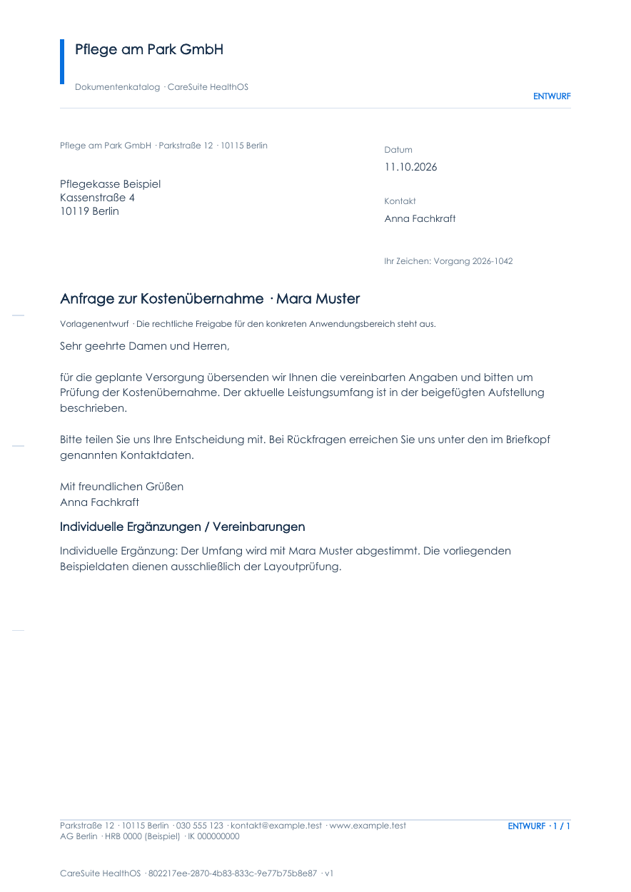
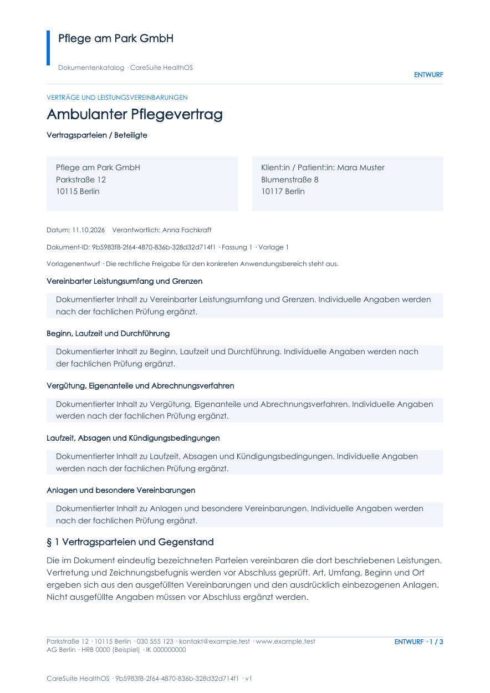
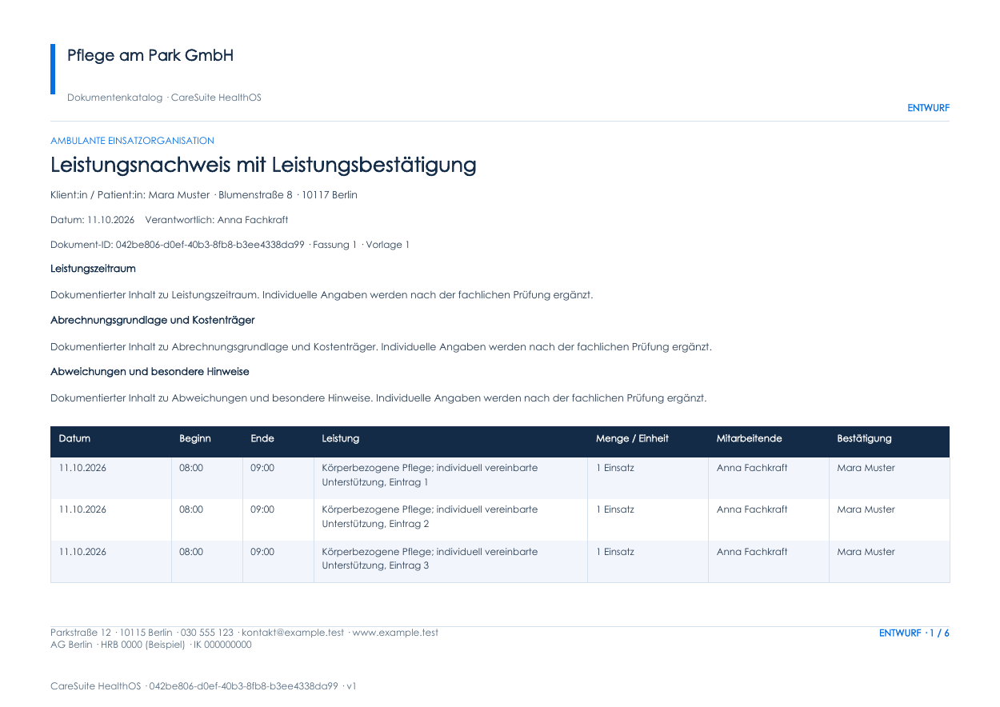
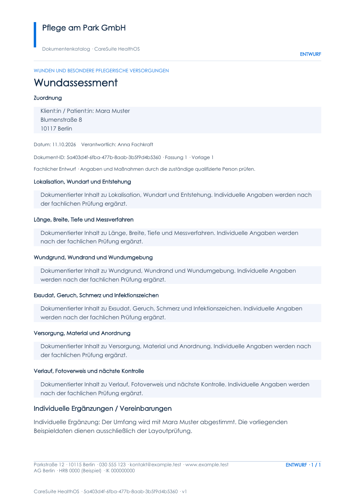

# PDF-Gestaltungsnachweise

Diese Bilder zeigen die erste Seite der vier mit dem tatsächlichen neuen Renderer erzeugten Prüfdokumente. Es wurden erfundene Daten und Beispielkontakte verwendet. Alle 430 Einträge wurden zusätzlich gerendert. Die vier Bilder sind keine Beschränkung des Katalogumfangs und keine Web-Browserprüfung.

Messbare Ergebnisse und verbleibende Lücken: [verification.json](verification.json). Entwicklungsstand: [IMPLEMENTATION_STATUS.md](../IMPLEMENTATION_STATUS.md). Gesamtliste: [CATALOG_430.md](../CATALOG_430.md).

## Fensterbrief

## Vertrag

## Nachweistabelle im Querformat

## Fachformular

