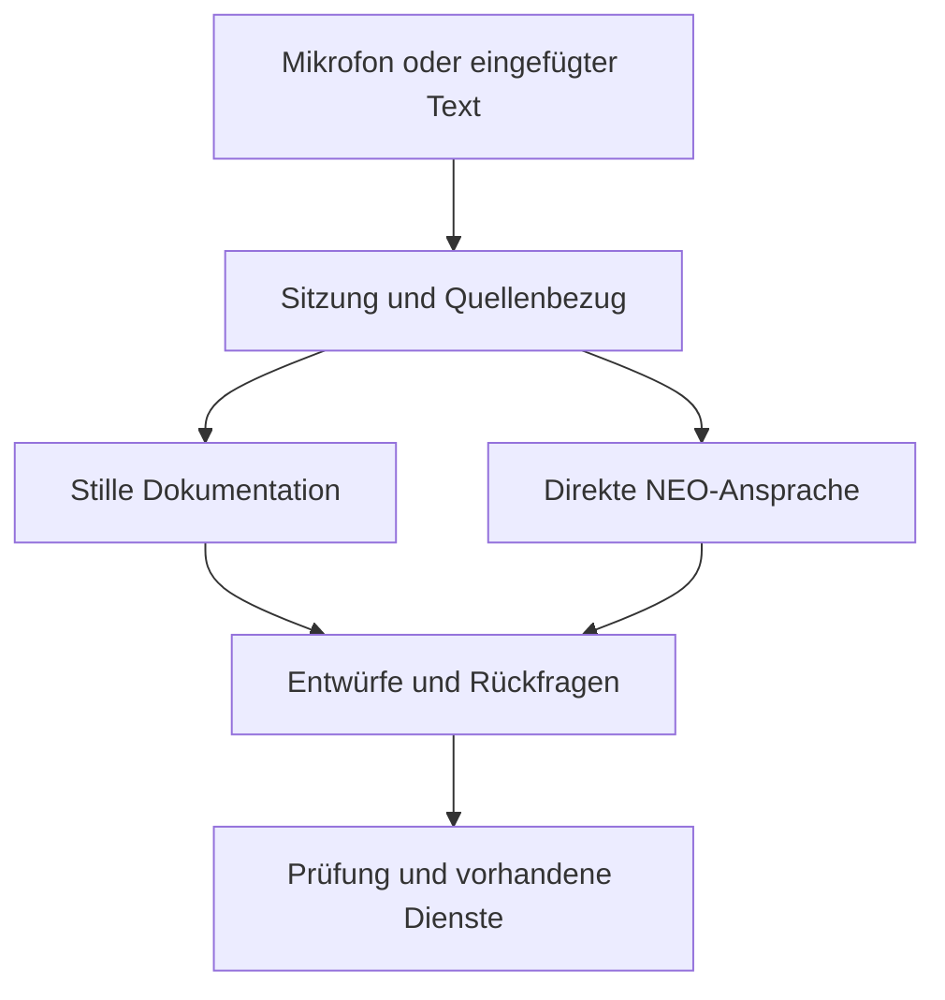

# NEO R2: Aufbau und Entwicklungsnachweis

Stand: 21.11.2026, Europe/Berlin. Diese Unterlage beschreibt den technischen Aufbau und die vorgesehenen Nachweise der R2-Erweiterung. Sie ist keine Patentanmeldung und enthält keine Feststellung der Patentfähigkeit oder Erfinderschaft. Die maschinenlesbare Fassung liegt in `docs/neo-r2-invention-record.json`.

## Ausgangsstand

Zu Beginn dieser Erweiterung war der CareSuite-Stand `5206930aa7b6d20b17b7495754e668d47b597a1a` im bestehenden Vercel-Produktionsprojekt als bereit gemeldet. Er enthält die R1-Dokumentationsentwürfe, die abgesicherten Terminaufträge und die Korrektur der Rollenangaben in den Tests. Diese Veröffentlichung belegt keine Freigabe der nachfolgend beschriebenen R2-Funktionen.

R1 erfasst Gesprächsabschnitte mit Personen- und Mandantenbezug. Die eigene Zuordnung kopiert belegte Aussagen, erhält Verneinungen und Fremdanamnese und bereitet einen prüfbaren Entwurf vor. Der vorhandene Termin- beziehungsweise Einsatzdienst bleibt für Schreibvorgänge zuständig. Der lokale Windows-Sprachdienst ist dadurch noch kein erreichbarer produktiver Erkennungsdienst für die Webanwendung.

## Technische Aufgabe

Während einer bewusst gestarteten Sitzung sollen Gesprächserfassung und Vorbereitung von Arbeitsschritten nebeneinander möglich sein. Eine direkte Ansprache von NEO soll einen zeitlich begrenzten Dialog öffnen, ohne jeden umgebenden Satz als Auftrag zu behandeln. Späte Erkennungsergebnisse dürfen nach Personen- oder Kontowechsel nicht in den neuen Fall gelangen. Wiederholte Ergebnisse dürfen keine doppelten Aufträge erzeugen. Überlastung muss sichtbar begrenzt werden, statt unbegrenzt Audiodaten und Arbeiten anzusammeln.

Eine akustisch unterscheidbare Stimme verrät weder die Identität noch die Rolle eines Menschen. Deshalb sind Sprecherkennung, bestätigte Rolle und fachliche Aussage getrennte Informationen. Die Zuordnung „Arzt“ darf beispielsweise nicht aus einer tieferen Stimme oder aus der Verwendung eines Medikamentennamens folgen.

## Aufbau

| Bestandteil | Verantwortung | Grenze |
| --- | --- | --- |
| `neoCapture.web.ts` / `neoCapture.native.ts` | Mikrofonbesitz, Erkennungsabschnitte, Abbruch und begrenzte Audioverarbeitung | Geräteschnittstellen und Erkennungsmodelle bestimmen die tatsächlich erreichbare Aufnahmequalität. |
| `neoSession.ts` | R2-Sitzungszustand, direkte Ansprache, Quellen, bestätigte Sprecherrollen und begrenzte Arbeitswarteschlange | Der Sitzungscontroller führt keine Datenbankschreibvorgänge aus. Die konkrete Integration wird am endgültigen Quellstand geprüft. |
| `neoDomain.ts` / `neoAssessment.ts` | Unveränderte Zitate, Themenzuordnung, Unsicherheit und Übernahme in einen lokalen Entwurf | Keine Diagnose, erfundene Ergänzung oder fachliche Freigabe. |
| `neoWork.ts` / `NeoWorkPanel.tsx` | Quellengebundene Vorbereitung weiterer Arbeitsentwürfe und Anzeige fehlender Angaben | Ein Entwurf ist kein gespeicherter Auftrag. Erfolge brauchen eine Bestätigung des zuständigen bestehenden Dienstes. |
| `neoActionService.ts` / `NeoActionsPanel.tsx` | Bestehende Termin- und Einsatzaktionen mit Berechtigungs-, Fall- und Bestätigungsprüfung | Unbestätigte beziehungsweise teilweise gespeicherte Änderungen bleiben als ungewiss erkennbar. |
| `neoConversation.web.ts` und native Ableitung | Dialog und Erläuterung des passenden Arbeitsablaufs | Die Erläuterung ersetzt keine ausgeführte Arbeit und keine serverseitige Berechtigung. |

Die genannten R2-Dateien werden in diesem Arbeitsschritt entwickelt. Der geschriebene Sitzungscontroller exportiert `createNeoSession`, `stripNeoWake`, `detectNeoWake` und `toNeoSegment`. Sein Ausgangszustand ist ausgeschaltet. Ein bestätigter Start öffnet den stillen Modus, eine direkte Ansprache ein standardmäßig 15 Sekunden langes Dialogfenster. Die Standardgrenzen betragen 200 Quellenabschnitte, 60.000 Zeichen, 24 ausstehende und drei gleichzeitig vorbereitete oder ausgeführte Arbeiten. Der Controller trennt Vorbereitung, Rückfrage, Bereitschaft, Bestätigung, Ausführung und Ergebnis. Ein Abbruch verwirft laufende Vorbereitungstoken und kennzeichnet bereits laufende Schreibarbeiten als ungewiss. Ein vorhandener Dateiname oder diese Tabelle ist kein Testbeleg. Der eingefrorene Veröffentlichungsstand muss die tatsächlich enthaltenen Dateien, deren Prüfsummen und die zugehörigen Prüfprotokolle ausweisen.

## Datenvertrag und Zustandswechsel

Jeder übernommene Textabschnitt besitzt eine Quellenkennung, Wortlaut und Zeitbezug. Der Fallbezug besteht aus Mandant, angemeldetem Akteur, ausgewählter Person und gegebenenfalls Assessment. Dieser Bezug wird bei Start und bei Verarbeitung geprüft. Eine Generation kennzeichnet den aktuellen Sitzungslauf. Abbruch und Fallwechsel machen ältere Verarbeitungsergebnisse unbrauchbar.

Im stillen Modus werden erkannte Inhalte als mögliche Dokumentationsquellen verarbeitet. Die lexikalische Erkennung einer direkten NEO-Ansprache im Transkript öffnet den Dialogmodus. Sie ist kein eigenständig trainiertes akustisches Aktivierungswortmodell. Ein Dialogfenster, ein klarer Stopp und ein sichtbarer Mikrofonzustand verhindern, dass eine gestartete Sitzung als unbegrenzt unsichtbarer Hintergrunddienst dargestellt wird. Betriebssysteme und Browser können Aufnahmen beim Hintergrundwechsel oder bei Sperrung unterbrechen.

Die parallele Vorbereitung mehrerer Arbeiten ist von gleichzeitigem Sprechen und Hören zu unterscheiden. Die Unterdrückung bekannter Assistenz- oder Echoereignisse im Sitzungscontroller belegt keine akustische Echokompensation und keinen funktionierenden Vollduplexbetrieb. Menschliche Unterbrechungen während einer Sprachausgabe brauchen einen gesonderten Endgerätetest.

Ein Arbeitsschritt verweist auf vorhandene Quellen. Fehlende Angaben erzeugen eine Rückfrage beziehungsweise einen noch unvollständigen Entwurf. Die Arbeitswarteschlange begrenzt ausstehende und gleichzeitig verarbeitete Einträge. Die Bestätigung eines Entwurfs, sein Ausführungsbeginn und das bestätigte Ergebnis sind verschiedene Zustände. Der bloße Abschluss einer Analyse zählt nicht als erfolgreich gespeicherte Arbeit.

Die geschriebene Arbeitsvorbereitung unterscheidet Aufgabe, Wiedervorlage und Übergabe. Bei Aufgaben und Wiedervorlagen fragt sie nach dem konkreten Inhalt, einer ausdrücklich bestätigten zuständigen Person und dem Fälligkeitsdatum. Eine Übergabe enthält vollständige Quellenzitate mit Sprecherangaben; sie behauptet keine neue medizinische Zusammenfassung. Änderungen an einem verwendeten Wortlaut, einer Sprecherzuordnung oder dem Fallbezug entwerten die frühere Prüfung. Die Oberfläche kann geprüfte Entwürfe zur Übernahme bereitstellen und die vorhandene Aufgabenplanung öffnen. Sie legt damit noch keine Aufgabe an und aktiviert keine Erinnerung.

Sprecher werden zunächst ohne fachliche Rolle geführt. Eine ausdrücklich bestätigte Zuordnung kann Klient:in, Pflegekraft, Angehörige, Arzt beziehungsweise Ärztin oder eine andere Person benennen. Eine spätere akustische Diarisierung darf lediglich Sprechersegmente beziehungsweise Sprecherkennungen liefern. Sie erhält dadurch keine Befugnis, Identität, Rolle oder inhaltliche Wahrheit festzulegen.

## Eigene Implementierung und bekannte Bausteine

Die CareSuite-spezifische Sitzungssteuerung, Fallbindung, Quellenprüfung, Auftragsvorbereitung und Einbindung der bestehenden Dienste werden als eigener Anwendungscode gepflegt. Daraus folgt keine Aussage, dass Zustandsautomaten, Warteschlangen, Wiederholschutz, Aktivierungswörter oder Quellenprüfung als allgemeine Verfahren neu seien.

Whisper und whisper.cpp sowie die schon verwendeten Sprachausgabe- und Gerätebibliotheken bleiben fremde Komponenten mit ihren jeweiligen Lizenzen. Neu recherchierte Erkennungs- oder Diarisierungsmodelle sind erst nach dokumentierter Auswahl, Lizenzprüfung und Messung auf den vorgesehenen Geräten Bestandteil des Produkts. Die R2-Unterlage erklärt insbesondere kein fremdes Basismodell zur eigenen Erfindung. Die Produktionsinfrastruktur ist auf Vercel und Supabase festgelegt; eine Recherche zu anderen Diensten ist keine Beauftragung dieser Anbieter.

## Nachweise vor einer erweiterten Freigabe

| Fragestellung | Prüfung | Zu erfassender Messwert beziehungsweise Beleg |
| --- | --- | --- |
| Wird NEO richtig angesprochen? | Direkte Ansprache, zitierte Nennung, ähnlich klingende Wörter, laufender Fernseher und verschiedene Sprechabstände | Fehlaktivierungen je Stunde, übersehene Ansprachen und Reaktionszeit ab Ansprache; verwendetes Modell und Endgerät festhalten. |
| Bleibt die Erfassung bei Arbeitsschritten erreichbar? | Längere deutsche Gespräche mit verzögertem Erkennungsdienst, Warteschlangenlast und Netzunterbrechung | Ausstehende Arbeiten, begrenzter Ressourcenverbrauch, sichtbare Überlastung und Verlust-/Wiederholverhalten. |
| Werden Fälle sauber getrennt? | Wechsel von Person, Konto und Assessment während einer laufenden Verarbeitung; Abbruch und Wiederanmeldung | Kein spätes Ergebnis im neuen Fall, kein Schreibversuch mit altem Fallbezug. |
| Bleiben Aufträge einmalig? | Doppelte Transkriptereignisse, wiederholte Bestätigung, abgebrochene Antwort und konkurrierender Schreibstand | Quellenkennung, Anfragekennung, tatsächlicher Dienstbeleg und eindeutig angezeigter Endzustand. |
| Wer spricht? | Einwilligungsbasiertes deutsches Testszenario mit getrennt annotierten Stimmen, Unterbrechungen und überlappender Sprache | Akustische Sprecherfehler getrennt von Rollenfehlern und ausdrücklich unzugeordneten Abschnitten messen. |
| Stimmen medizinische Aussagen? | Fachlich geprüfte Referenzfälle mit Verneinung, Zeitbezug, Fremdanamnese und unklaren Angaben | Wortfehler, falsche Quellenzuordnung, unbelegte Ergänzungen und notwendige Korrekturen getrennt erfassen. |
| Ist der Ablauf bedienbar? | Breite und schmale Oberfläche, Mikrofonfreigabe, Stopp, Hintergrundwechsel, Rückfrage und Übernahme | Geräte-/Browserstand, sichtbare Zustände und offene Bedienungslücken. Ein DOM-Test allein belegt kein Layout. |

Für diese R2-Gerätemessungen werden hier keine Ergebnisse behauptet. Akzeptanzgrenzen und Testfälle müssen vor der Auswertung feststehen. Die lokalen automatisierten Tests und der erfolgreiche Produktionsbuild werden mit ihrem tatsächlichen Umfang getrennt dokumentiert.

## Entwicklungsunterlagen und mögliche Schutzrechte

Für einen späteren fachlichen Abgleich sollen pro abgeschlossenem Stand die genaue technische Aufgabenstellung, die gewählte Ausführung, verworfene Varianten, Quell- und Modellversionen, Prüfsummen und unveränderte Prüfprotokolle erhalten bleiben. Menschliche Beiträge werden mit Person, Datum und konkretem Beitrag festgehalten. KI-Unterstützung wird als solche dokumentiert; die Erfinderbenennung wird daraus nicht automatisch abgeleitet. Nach der EPO-Praxis kommen für die Benennung natürliche Personen in Betracht. [5]

Ein lokaler Zeitstempel kann geändert werden. Eine SHA-256-Prüfsumme ermöglicht den Vergleich von Dateiinhalten, belegt aber für sich weder deren Entstehungszeit noch Erfinderschaft. Bei Quelltextvergleichen kann für Windows und andere Plattformen eine dokumentierte UTF-8-/LF-Normalisierung verwendet werden; ein Archivhash bezieht sich dagegen auf die unveränderten Archivbytes. Ein privater Nachweis braucht deshalb einen nachvollziehbaren Ablage- und Änderungsverlauf. Vertrauliche Varianten, Anspruchsüberlegungen und personenbezogene Entwicklungsbeiträge gehören in eine getrennte private Akte, beispielsweise unter dem von Git ausgeschlossenen `.neo-runtime`, und in eine dauerhafte private Sicherung. Gesundheitsdaten und private Dienstgeheimnisse gehören nicht in diese Akte.

Diese beiden versionierten R2-Dateien sind als veröffentlichungsfähige technische Unterlagen verfasst. Das Repository ist bereits öffentlich; ein öffentlicher Push weiteren Codes oder dieser Beschreibung kann weitere technische Inhalte offenlegen. Eine private Ablage daneben macht eine vorherige Veröffentlichung nicht rückgängig. § 3 PatG und Artikel 54 EPÜ knüpfen die Neuheit an den vor dem maßgeblichen Anmeldetag öffentlich zugänglichen Stand der Technik. [1, 2] Die Schutzfähigkeit eines Computerprogramms hängt nicht allein davon ab, dass neuer Code geschrieben wurde; für den Patentschutz sind die konkrete technische Lehre und die weiteren Voraussetzungen zu prüfen. [3, 4] Der Schutz von Ausdrucksformen eines Computerprogramms nach § 69a UrhG ist davon zu unterscheiden; zugrundeliegende Ideen und Grundsätze werden dadurch nicht geschützt. [6]

Eine Neuheitsrecherche, eine Prüfung bestehender Schutzrechte und eine Entscheidung über eine Anmeldung wurden mit dieser Bauunterlage nicht erledigt. Sie hält den Entwicklungsstand nachvollziehbar fest, ohne einen Patentanspruch oder einen rechtlichen Schutzstatus zu behaupten.

## Primärquellen

Abrufdatum für die rechtlichen Quellen: 21.11.2026. Die Produkt- und Codereferenzen beziehen sich auf den bezeichneten CareSuite-Stand.

1. [§ 3 PatG: Neuheit und Stand der Technik](https://www.gesetze-im-internet.de/patg/__3.html).
2. [EPO, Artikel 54 EPÜ: Novelty](https://www.epo.org/en/legal/epc/2020/a54.html).
3. [DPMA: Computerimplementierte Erfindungen](https://www.dpma.de/schuetzen/patente/patentschutz/schutzvoraussetzungen/computerimplementierte-erfindungen).
4. [EPO Guidelines 2026, G-II 3.6: Programs for computers](https://www.epo.org/en/legal/guidelines-epc/2026/g_ii_3_6.html).
5. [EPO: Inventorship, Stand 14.08.2026](https://www.epo.org/en/news-events/in-focus/digital-innovations/inventorship).
6. [§ 69a UrhG: Gegenstand des Schutzes von Computerprogrammen](https://www.gesetze-im-internet.de/urhg/__69a.html).
7. [DPMA: Tipps zu Recherche und Lizenz](https://www.dpma.de/service/informationen-fuer/freie-erfinderinnen-und-erfinder/tipps-zu-recherche-und-lizenz).
8. [whisper.cpp: Quellcode und Lizenz](https://github.com/ggml-org/whisper.cpp).
9. [Whisper: Quellcode, Modelle und Lizenzhinweise](https://github.com/openai/whisper).
